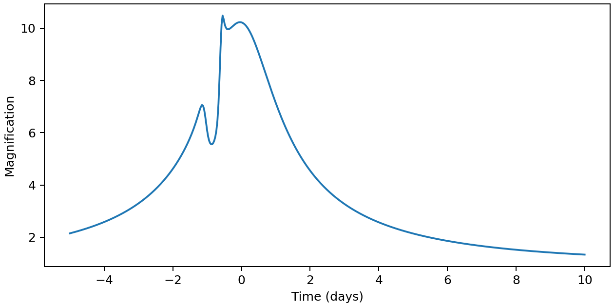

# microJAX


microJAX models gravitational microlensing by binary and triple lenses.
It calculates finite-source light curves with limb darkening, and uses JAX
to differentiate them with respect to the lens and event parameters.
Magnifications and derivatives can be evaluated on CPU or GPU.

## Getting started

Install the development version used by the examples below:

```bash
python -m pip install "microjaxx @ git+https://github.com/ShotaMiyazaki94/microjax.git@develop" matplotlib
```

The pip package is named `microjaxx`; the Python module is `microjax`.
The [installation guide](docs_src/getting_started.rst) also covers source
checkouts and GPU setup.

This example describes a source passing a binary lens with mass ratio
`q=0.001` and separation `s=1` Einstein radius:

```python
import jax
jax.config.update("jax_enable_x64", True)

import jax.numpy as jnp
import matplotlib.pyplot as plt
import microjax as mj

times = jnp.linspace(-5.0, 10.0, 500)
lightcurve = mj.make_binary_lightcurve(times, backend="cpu")
parameters = dict(
    t0=0.0, tE=10.0, u0=0.1, alpha=jnp.deg2rad(50.0),
    q=0.001, s=1.0, rho=0.005, u1=0.5,
)
A = lightcurve(parameters)

plt.plot(times, A)
plt.xlabel("Time (days)")
plt.ylabel("Magnification")
plt.show()
```



The [first tutorial](docs_src/usage.rst) explains the trajectory, lens
parameters, and the short feature near the peak. Continue with
[differentiating a light curve](docs_src/autodiff.rst) to see which parts
of the event constrain each parameter, or run the complete
[binary and triple examples](example/README.md).
For single-lens models, see [singlens](https://github.com/ShotaMiyazaki94/singlens).

## Documentation

The guides in [docs_src/](docs_src/index.rst) describe this branch, including
[working with JAX](docs_src/working_with_jax.rst),
[accuracy and speed benchmarks](docs_src/benchmarks.rst), and the
[API reference](docs_src/modules.rst).
The [published website](https://shotamiyazaki94.github.io/microjax/) follows `develop`.

To preview the documentation from a source checkout:

```bash
python -m pip install -e '.[dev]'
python -m sphinx -b html -W docs_src docs
```

Open `docs/index.html`. The [contribution guide](CONTRIBUTING.md) has the
test and publishing instructions. Questions and suggestions are welcome
in [GitHub issues](https://github.com/ShotaMiyazaki94/microjax/issues).

## Citation and license

If you use microJAX, please cite Miyazaki & Kawahara (2025), ApJ, 994, 144
([paper](https://doi.org/10.3847/1538-4357/ae1005)) and the
[software archive](https://doi.org/10.5281/zenodo.17247892).
See the [citation guide](docs_src/citing.rst) for BibTeX and version information.

microJAX is released under the [MIT License](LICENSE).
Code adapted from `caustics` retains its [MIT notice](LICENSES/caustics-MIT.txt).
