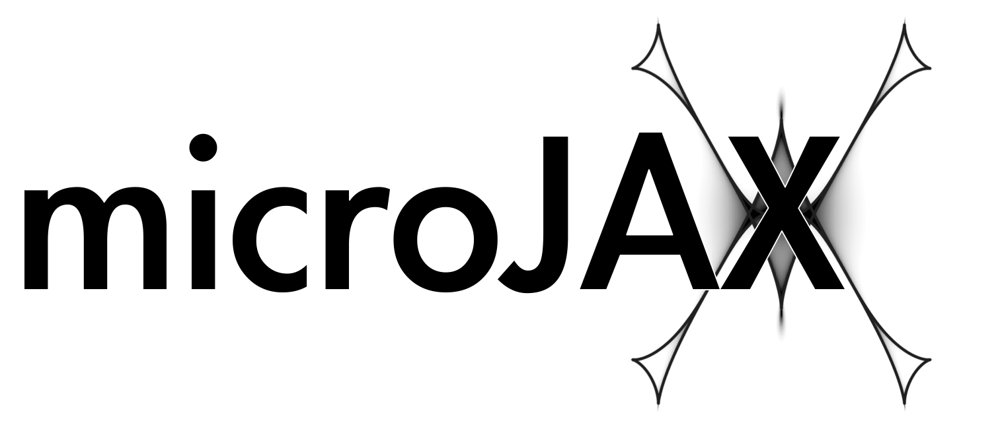

# microJAX

microJAX models gravitational microlensing by binary and triple lenses.
It calculates finite-source light curves with limb darkening, and uses JAX
to differentiate them with respect to the lens and event parameters.
Magnifications and derivatives can be evaluated on CPU or GPU.

**[Documentation](https://shotamiyazaki94.github.io/microjax/)**

[Installation](https://shotamiyazaki94.github.io/microjax/getting_started.html) ·
[Tutorials](https://shotamiyazaki94.github.io/microjax/usage.html) ·
[Examples](https://shotamiyazaki94.github.io/microjax/examples/index.html) ·
[Benchmarks](https://shotamiyazaki94.github.io/microjax/benchmarks.html) ·
[API reference](https://shotamiyazaki94.github.io/microjax/modules.html)

If you use microJAX in your research, see the
[citation guide](https://shotamiyazaki94.github.io/microjax/citing.html).

microJAX is released under the [MIT License](LICENSE).
Code adapted from `caustics` retains its [MIT notice](LICENSES/caustics-MIT.txt).
