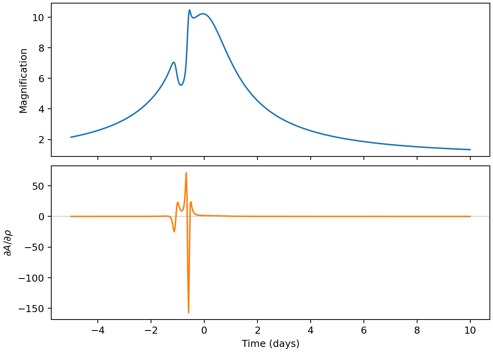

Differentiating a light curve
=============================

A derivative tells us how the model changes when we adjust a parameter.
For example, the source-radius derivative shows which parts of the light
curve are sensitive to the star's size. Here we calculate derivatives for
the parameters of the :doc:`binary event <usage>`.

Writing a model function
------------------------

The light-curve function accepts a seven-element parameter array and
observation times. We differentiate the event parameters, keeping the times
and limb-darkening coefficient fixed:

.. code-block:: python

   import jax
   jax.config.update("jax_enable_x64", True)

   import jax.numpy as jnp
   import matplotlib.pyplot as plt
   import microjax as mj

   times = jnp.linspace(-5.0, 10.0, 500)
   lightcurve = mj.make_binary_lightcurve(backend="cpu")
   # t0, tE, u0, q, s, alpha, rho
   parameters = jnp.array([
       0.0, 10.0, 0.1, 0.001, 1.0, jnp.deg2rad(50.0), 0.005,
   ])

The parameter order is ``t0, tE, u0, q, s, alpha, rho``. We pass the
limb-darkening coefficient separately as ``u1=0.5``.

Calculating the Jacobian
------------------------

The Jacobian is a table of derivatives: each row corresponds to an
observation time, and the seven columns follow the parameter order above.
``jax.jacfwd`` creates a function that calculates this table.
``argnums=0`` selects the parameter argument for differentiation.
Wrapping the result in ``jax.jit`` compiles it for repeated use:

.. code-block:: python

   derivative = jax.jit(jax.jacfwd(lightcurve, argnums=0))
   jacobian = derivative(parameters, times, u1=0.5)
   print(jacobian.shape)

.. code-block:: text

   (500, 7)

The first call includes compilation. Subsequent calls with the same array
shapes and numeric types reuse it. ``jacfwd`` uses forward-mode automatic
differentiation, which follows how changes in each input affect the outputs.
It works for both CPU and GPU models. The CPU calculation uses adaptive
loops, so use ``jacfwd``; JAX's reverse-mode alternatives, ``grad`` and
``jacrev``, cannot differentiate those loops.

Looking at one derivative
-------------------------

Let's plot :math:`\partial A/\partial\rho` below the magnification so we
can see where the source size matters:

.. code-block:: python

   A = jax.jit(lightcurve)(parameters, times, u1=0.5)

   fig, axes = plt.subplots(2, 1, figsize=(7, 5), sharex=True,
                            layout="constrained")
   axes[0].plot(times, A, color="C0")
   axes[0].set_ylabel("Magnification")
   axes[1].axhline(0, color="0.8", linewidth=0.8)
   axes[1].plot(times, jacobian[:, 6], color="C1")
   axes[1].set(xlabel="Time (days)", ylabel=r"$\partial A / \partial\rho$")
   plt.show()

   Sensitivity to source radius is concentrated around the caustic feature.

Where the derivative is positive, a small increase in ``rho`` raises the
magnification; where it is negative, the magnification falls. The nearly
flat derivative far from the feature shows why those observations alone
provide little information about the source radius.

For a flux model :math:`F=F_s A+F_b`, the derivative with respect to an event
parameter is simply :math:`F_s\,\partial A/\partial p`. These are the
quantities a least-squares fit uses to update the event parameters.

Values and derivatives in one call
----------------------------------

A fit usually needs both the light curve and its Jacobian. With
``has_aux=True``, ``jacfwd`` differentiates the first return value and passes
the second through unchanged. Returning the curve twice gives us both
results from the same calculation:

.. code-block:: python

   def with_value(p, times):
       A = lightcurve(p, times, u1=0.5)
       return A, A

   value_and_jacobian = jax.jit(jax.jacfwd(with_value, argnums=0, has_aux=True))
   jacobian, A = value_and_jacobian(parameters, times)

For a triple lens, the same pattern applies with three additional parameters
and ``make_triple_lightcurve``. The :doc:`examples/index` keep ``u1`` fixed
and plot the seven binary and ten triple event derivatives, with complete
scripts for both CPU and GPU.
