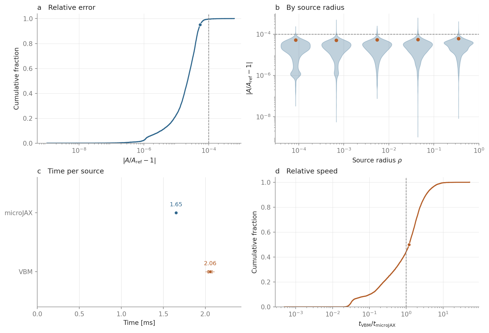

Benchmarks
==========

These figures compare **microJAX on CPU** with **VBMicrolensing (VBM)** for
binary lenses with linear limb darkening, ``u1=0.5``. Both codes receive the
same lens parameters and source position. The overview shows the overall
error and timing distributions; the maps show where they change.

Overall accuracy and speed
--------------------------

In this sample, **typical relative differences are below** :math:`10^{-4}`:
99.5% of the 12,244 checked positions fall below that level. The median is
:math:`2.24\times10^{-5}` and the 95th percentile is
:math:`5.46\times10^{-5}`. Here, relative error means
:math:`\epsilon=|A_{\rm microJAX}/A_{\rm ref}-1|`, using the saved reference
described below. The largest difference is :math:`6.19\times10^{-4}`.

   **a:** cumulative error distribution; **b:** error distributions by source
   radius, with orange dots at the 95th percentile. Dashed lines mark
   :math:`10^{-4}`. **c:** median time per source; **d:** the distribution of
   paired runtime ratios. Thick and thin bars show 68.27% and 95% bootstrap
   intervals for the marked estimates.

The median paired speed ratio is **1.20**, with a 95% interval of
[1.17, 1.22]. The ratio is :math:`t_{\rm VBM}/t_{\rm microJAX}`: values above
one favour microJAX, and values below one favour VBM. It is calculated for
each source before taking the median.

What was compared
-----------------

Each measurement evaluates the magnification of **one finite source** on
the same CPU. microJAX uses its full CPU integrator, bypassing the multipole
shortcut in the public light-curve API. VBM uses ``BinaryMag2`` with its own
normal method selection. The figures therefore measure this single-source
workload; complete light curves also depend on batching and the frequency
of full finite-source calculations.

The VBM call used for the timing comparison is:

.. code-block:: python

   import VBMicrolensing

   vbm = VBMicrolensing.VBMicrolensing()
   vbm.Tol = 1e-4
   vbm.RelTol = 1e-4
   vbm.a1 = 0.5
   A_vbm = vbm.BinaryMag2(s, q, x, y, rho)

.. list-table:: Measurement settings
   :header-rows: 1
   :widths: 30 70

   * - Setting
     - Value
   * - Source profile
     - Linear limb darkening: microJAX ``u1=0.5``, VBM ``a1=0.5``.
   * - VBM accuracy controls
     - Absolute ``Tol=1e-4`` and relative ``RelTol=1e-4``.
   * - microJAX integration
     - 112 boundary samples; adaptive two-moment integration with an internal
       relative indicator of ``1e-4`` and a limit of 84 rays per support cell.
   * - Timing
     - Median of three calls per source after warm-up. JAX results are
       synchronized before stopping the timer.
   * - Excluded from timing
     - Compilation, warm-up, worker startup, and communication between processes.
   * - Software and device
     - JAX/JAXLIB 0.8.0 with float64; VBMicrolensing 5.3.5;
       macOS 26.5 arm64 CPU.

The two methods run sequentially, with their order randomized across
configurations. A pair enters the speed statistics when both outputs are
finite, positive, and within :math:`10^{-3}` of the saved reference.
This leaves 12,236 pairs; eight measured pairs fail that selection.

The **accuracy reference is separate from the timed VBM call**. It contains
saved VBBinaryLensing values, with selected difficult cases rechecked using
VBMicrolensing at ``Tol=RelTol=1e-8``. The error panels compare microJAX
with these saved values, rather than with the fresh ``1e-4`` timing call.
The reference set has mixed precision; ``1e-8`` applies to the targeted
rechecks. The
`benchmark runner <https://github.com/ShotaMiyazaki94/microjax/blob/develop/tools/cpu_benchmark_grid.py>`_
records the input hashes and settings alongside each run.

Variation across the parameter range
------------------------------------

The grid contains 29 mass ratios, 25 separations, and 17 source radii:
``q=1e-6..1``, ``s=0.5..1.5``, and ``rho=3e-5..1``. This includes planetary
and comparable-mass lenses. One source position is selected for each of the
12,325 configurations from a stored set of caustic-centred positions.
Selection balances the available mass-ratio, source-radius, and
magnification bins. Of these positions, 81 have no usable reference;
12,244 enter the accuracy comparison.

.. figure:: _static/cpu_parameter_maps_ld.png
   :alt: Regional median speed ratios and 95th-percentile errors across mass ratio, source radius, and reference magnification
   :width: 100%
   :target: _static/cpu_parameter_maps_ld.png

   **a–c:** median runtime ratio, VBM/microJAX.
   **d–f:** 95th-percentile relative error. Grey cells have too few measured
   configurations or no sources in the saved reference frame.

The columns group the same measurements by :math:`(q,\rho)`,
:math:`(A_{\rm ref},\rho)`, and :math:`(A_{\rm ref},q)`; separation ``s``
is pooled within each cell. Estimates need at least 15 configurations,
and error percentiles need at least 50 positions.

Uncertainty is shown in the
`regional interval figure <_static/cpu_regional_intervals_ld.png>`_. Each
row is a :math:`q`–:math:`\rho` region; indices run from the lowest to the
highest of the five logarithmic bins on each axis. Thick bars span 68.27%
(about 1σ) and thin bars 95%. These intervals come from 4,000 resamples of
whole configurations within :math:`q`–:math:`\rho` groups. They describe
uncertainty in the median or percentile, rather than the scatter of
individual errors. They do not include uncertainty in the saved reference.
Exact values, standard errors, and counts remain in ``regional_statistics.csv``.

The figures use the measurement at
`998c548 <https://github.com/ShotaMiyazaki94/microjax/commit/998c548>`_
on 6 November 2026. This is a grid of selected caustic-region positions,
so the overall distributions describe that sample of events.

Running a comparison
--------------------

For a quick check on your own machine, run the bundled binary and triple
cases from a source checkout:

.. code-block:: sh

   python tools/cpu_benchmark.py --output results/cpu-benchmark.json

This checks magnification against saved references and measures warm
runtimes for magnification and forward Jacobians. Use ``--lens binary`` or
``--lens triple`` to run one model. The cases include central and third-body
caustics, comparable masses, and small mass ratios; their inputs and reference
methods are recorded in
`cpu_benchmark_cases.json <https://github.com/ShotaMiyazaki94/microjax/blob/develop/tools/cpu_benchmark_cases.json>`_
and
`cpu_triple_cases.json <https://github.com/ShotaMiyazaki94/microjax/blob/develop/tools/cpu_triple_cases.json>`_.

A recorded run at
`e1d8f59 <https://github.com/ShotaMiyazaki94/microjax/commit/e1d8f59d8317369f60fbebbdacea545955d767d3>`_
found maximum relative differences of :math:`7.15\times10^{-5}` over
48 binary positions and :math:`7.22\times10^{-6}` over six triple positions.
These small cases complement the broader binary map above. The generated
JSON report contains the settings, accuracy, and timings for your own run.

Recreating the maps
~~~~~~~~~~~~~~~~~~~

The regional benchmark needs a dense reference CSV and its same-stem JSON
metadata, which are not bundled with the package. If you have those inputs:

.. code-block:: sh

   python -m pip install VBMicrolensing matplotlib
   python tools/cpu_benchmark_grid.py \
       --reference-data /path/to/xdense_cpu.csv \
       --output-dir results/cpu/new-run/data --time-budget 300
   python tools/plot_cpu_benchmark.py \
       --data-dir results/cpu/new-run/data \
       --output-dir results/cpu/new-run/figures

The 300-second measurement budget includes selection and compilation.
Plotting requires a completed run. Alongside the figures,
``regional_statistics.csv`` contains the estimates, bootstrap standard
errors, 68.27% and 95% intervals, and sample counts for each region.
