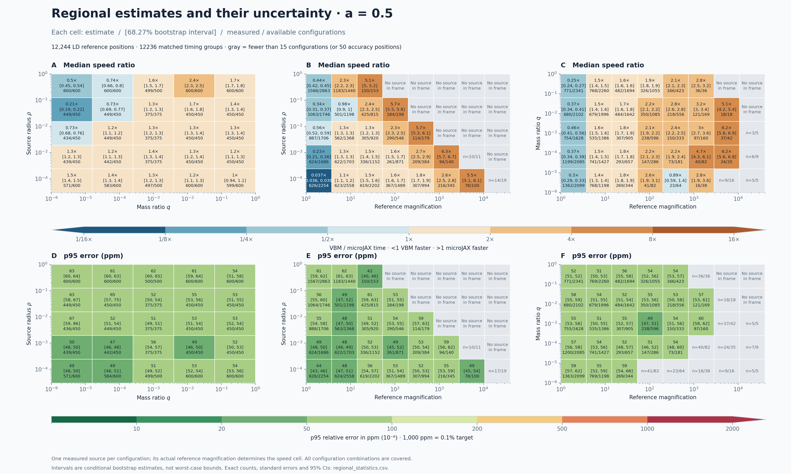

Benchmarks
==========

Measure linear limb-darkened magnification and forward-Jacobian runtime
with ``u1=0.5`` and float64. The small CPU benchmark uses bundled reference
cases; the optional regional benchmark adds coverage maps and comparisons
with VBMicrolensing. See :doc:`caveats` for measured value and derivative
accuracy, and :doc:`performance` for timing your own light curve.

Regional binary maps
--------------------

   Binary lenses with linear limb darkening, ``u1=0.5`` (labelled ``a`` in
   the figure). Upper row: median VBM/microJAX runtime ratio; values above
   one mean microJAX is faster. Lower row: the 95th-percentile relative
   magnification error in ppm. Brackets give 68.27% bootstrap intervals for
   the statistic; fractions show measured/available configurations.
   Click the figure to enlarge it.

This run was measured on 6 November 2026 with the CPU implementation in
`998c548 <https://github.com/ShotaMiyazaki94/microjax/commit/998c548>`_,
JAX/JAXLIB 0.8.0, and VBMicrolensing 5.3.5 on an arm64 CPU running macOS 26.5.
It compares 12,244 reference positions and 12,236 paired timings, using the
full finite-source integral with multipole screening disabled.

The regional benchmark selects one source position for each of 12,325
binary configurations. Its input frame spans ``q=1e-6..1``,
``s=0.5..1.5``, and ``rho=3e-5..1``, with positions near a selected caustic
component. Selection first covers occupied mass-ratio, source-radius, and
magnification bins, then balances the remaining configurations.

This comparison uses the full CPU finite-source calculation and matched
single-position VBMicrolensing timings. It requires VBMicrolensing,
Matplotlib, and a separately supplied dense reference CSV with same-stem
JSON metadata. The reference files contain 36 source positions per
configuration and are not bundled with microJAX.

.. code-block:: sh

   python -m pip install VBMicrolensing matplotlib
   python tools/cpu_benchmark_grid.py \
       --reference-data /path/to/xdense_cpu.csv \
       --output-dir results/cpu/new-run/data --time-budget 300
   python tools/plot_cpu_benchmark.py \
       --data-dir results/cpu/new-run/data \
       --output-dir results/cpu/new-run/figures

Use a new output directory for each run. The measurement budget defaults
to 300 seconds, including selection and compilation. A run that reaches
the budget records its incomplete status; plotting requires complete
coverage.

Reading the figures
~~~~~~~~~~~~~~~~~~~

The overview shows cumulative error and speed-ratio distributions,
error violins by source size, and median runtimes.
Parameter maps show median speed ratio, 95th-percentile relative error,
and measured/available sample counts for each region. A speed ratio above
one means microJAX is faster.

Uncertainty comes from 4,000 bootstrap draws of whole configurations within
mass-ratio/source-radius strata. The displayed 68.27% and 95% intervals
describe uncertainty in each representative statistic. The reported
``standard_error`` is the standard deviation of the bootstrap estimates:
it measures the uncertainty of the median or percentile, rather than the
scatter of individual errors or speeds.

The intervals are conditional on this source-selection design. Regions
with fewer than 15 configurations, or fewer than 50 accuracy positions,
retain their counts but omit uncertainty intervals. Exact estimates,
standard errors, intervals, and counts are saved in
``regional_statistics.csv`` alongside the figures.

Critical CPU cases
------------------

Run from a source checkout:

.. code-block:: sh

   python tools/cpu_benchmark.py --output results/cpu-benchmark.json

Use ``--lens binary`` or ``--lens triple`` for one model. The default runs
both: three binary batches of 16 positions, six single-position triple
cases, and one forward Jacobian per lens model. These include thin images,
central and third-body caustics, comparable masses, and mass ratios down
to ``1e-6``. The exact parameters and reference methods are in
`cpu_benchmark_cases.json <https://github.com/ShotaMiyazaki94/microjax/blob/develop/tools/cpu_benchmark_cases.json>`_
and
`cpu_triple_cases.json <https://github.com/ShotaMiyazaki94/microjax/blob/develop/tools/cpu_triple_cases.json>`_.

The benchmark reports the maximum relative magnification difference and
median synchronized runtime for each case. Compilation is excluded;
``--repeats`` defaults to five. It exits with an error if a value differs
from its reference by more than ``1e-3``. Jacobian timing checks finite
outputs; the focused tests compare derivatives with independent references.

Recorded runtime
~~~~~~~~~~~~~~~~

The following run used
`e1d8f59 <https://github.com/ShotaMiyazaki94/microjax/commit/e1d8f59d8317369f60fbebbdacea545955d767d3>`_,
Python 3.11.3, JAX/JAXLIB 0.8.0, and an arm64 CPU on macOS 26.5.
Times are medians of three synchronized calls after compilation
(``--repeats 3``).

.. list-table::
   :header-rows: 1
   :widths: 65 35

   * - Workload
     - Warm time
   * - Binary Cartesian case, 16 positions
     - 17.13 ms
   * - Binary angular case, 16 positions
     - 21.54 ms
   * - Binary mixed case, 16 positions
     - 18.09 ms
   * - Triple cases, one position per call
     - 3.18–9.61 ms
   * - Binary Jacobian, five parameters at one position
     - 3.53 ms
   * - Triple Jacobian, ten parameters at one position
     - 15.24 ms

The triple range covers six separate configurations. The binary case names
identify the fixture groups. The JSON report records the environment,
sample counts, timings, and reference differences for a new run.
