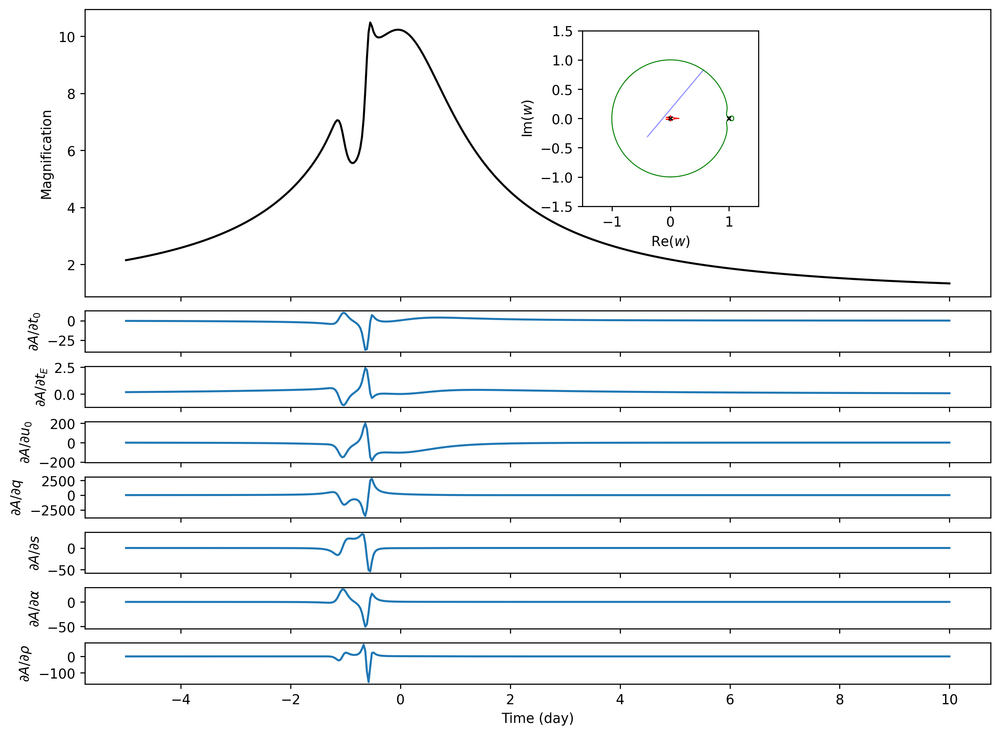
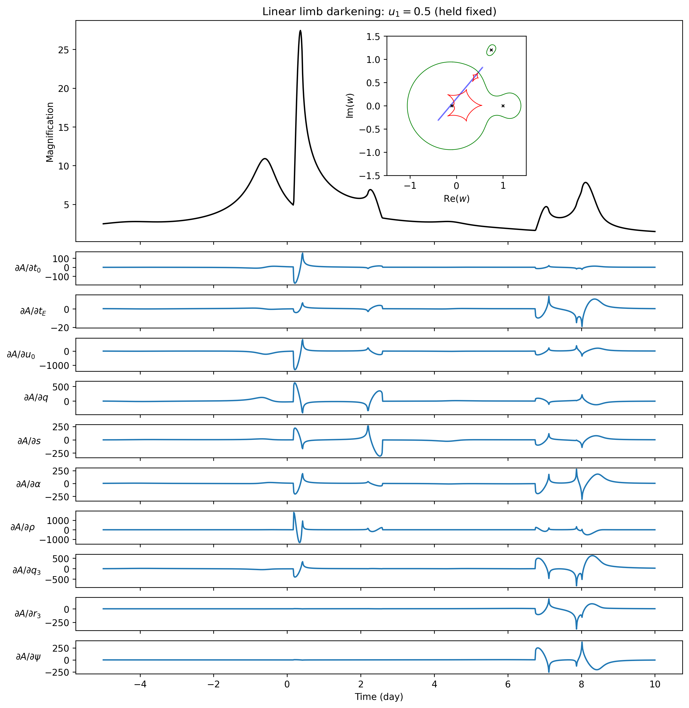

Binary and triple examples
==========================

These examples put the light curve, lens geometry, and parameter derivatives
in one figure. They are useful starting points for exploring an event of
your own. The CPU and GPU versions use the same parameters and observation
times, with linear limb darkening fixed at ``u1=0.5``.

For posterior sampling and an injection–recovery test, see :doc:`../inference`.

Run the commands below from a :doc:`local copy of the repository <../getting_started>`
with Matplotlib installed. The CPU examples share one
:download:`script <../../example/cpu/lightcurve.py>`; edit ``params`` and
``times`` in its ``main()`` function to change the event.

Binary lens
-----------

.. code-block:: sh

   python example/cpu/lightcurve.py

This is the event from :doc:`../usage`: a low-mass companion with
``q=0.001`` and ``s=1``, observed along a trajectory that passes close to a
caustic. The source radius is ``rho=0.005``. The upper panel shows the
magnification, and the seven panels below it show how the light curve
responds to ``t0, tE, u0, q, s, alpha, rho``.

   The inset shows the source trajectory in blue, caustics in red, and
   critical curves in green. Black crosses mark the lens positions.

The derivatives are largest around the short feature before the peak.
They also have different shapes: changing the event time shifts the feature,
while changing the source radius changes its smoothing. The
:doc:`differentiation tutorial <../autodiff>` explains how to obtain these
curves from a model function.

.. _triple-example:

Triple lens
-----------

.. code-block:: sh

   python example/cpu/lightcurve.py --lens triple

Here the first two lenses have ``q=0.1`` and ``s=1.1``. A third lens has
mass ratio ``q3=0.01`` relative to the primary and lies at ``0.3+1.2j``
relative to the binary midpoint. The parameter array contains the seven
binary event parameters followed by ``q3, r3, psi``:

.. code-block:: python

   # t0, tE, u0, q, s, alpha, rho, q3, r3, psi
   triple_parameters = jnp.array([
       0.0, 10.0, 0.1, 0.1, 1.1, jnp.deg2rad(50.0), 0.01,
       0.01, abs(0.3 + 1.2j), jnp.angle(0.3 + 1.2j),
   ])
   triple_times = jnp.linspace(-5.0, 10.0, 1000)
   triple_lightcurve = mj.make_triple_lightcurve(backend="cpu")
   A_triple = triple_lightcurve(triple_parameters, triple_times, u1=0.5)

The script samples 1000 times and differentiates all ten event parameters,
adding ``q3, r3, psi`` to the binary parameters. The source coordinate
origin is still the centre of mass of the first two lenses; see the
:ref:`coordinate conventions <lens-coordinates>` for the conversion between
this origin and the binary midpoint.

   A triple-lens event and its ten parameter derivatives, calculated on the CPU.

Running on a GPU
----------------

With a GPU-enabled JAX installation, run the corresponding scripts:

.. code-block:: sh

   python example/gpu/jacobian-binary/code/jacobian.py
   python example/gpu/jacobian-triple/code/jacobian.py

The `binary <https://github.com/ShotaMiyazaki94/microjax/tree/develop/example/gpu/jacobian-binary>`_
and `triple <https://github.com/ShotaMiyazaki94/microjax/tree/develop/example/gpu/jacobian-triple>`_
example READMEs describe the timing and output options.

Saved results
-------------

The CPU script saves ``lightcurve.png``, ``lightcurve.csv`` (time and
magnification), and ``jacobian_forward.npy`` under ``results/cpu/example/``.
Triple results go in its ``triple/`` subdirectory. You can load these files
in a notebook to explore the results without repeating the calculation.
GPU results go under each script's ``outputs/`` directory.
