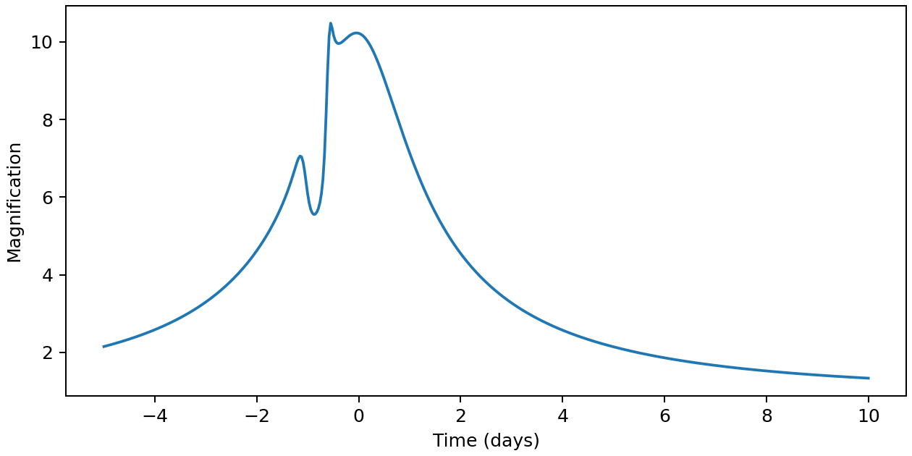

microJAX
========

microJAX models gravitational microlensing by binary and triple lenses.
It calculates finite-source light curves with limb darkening and uses JAX
to differentiate them with respect to lens and event parameters.
Magnifications and derivatives can be evaluated on CPU or GPU.

If you are new to microJAX, start with :doc:`getting_started`, then work
through :doc:`usage`. That tutorial goes from event parameters to the
light curve below. :doc:`autodiff` builds on the same event. Complete
scripts are in :doc:`examples/index`.

   A binary-lens event calculated in the first tutorial.

.. toctree::
   :caption: Getting started
   :maxdepth: 1

   getting_started

.. toctree::
   :caption: Tutorials
   :maxdepth: 1

   usage
   autodiff
   inference
   examples/index

.. toctree::
   :caption: Reference
   :maxdepth: 1

   working_with_jax
   benchmarks
   modules
   citing

The methods are described in
`Miyazaki & Kawahara (2025) <https://doi.org/10.3847/1538-4357/ae1005>`_.
See :doc:`citing` if you use microJAX in your work. For single-lens models,
see `singlens <https://github.com/ShotaMiyazaki94/singlens>`_.

Questions, bug reports, and suggestions are welcome on
`GitHub <https://github.com/ShotaMiyazaki94/microjax/issues>`_.
