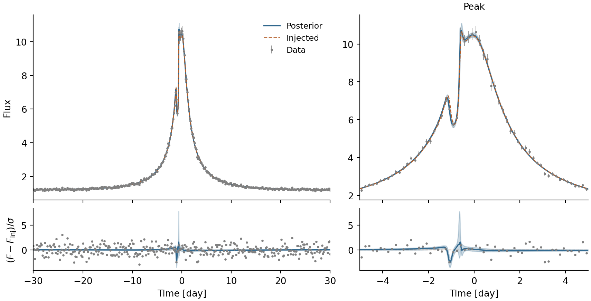
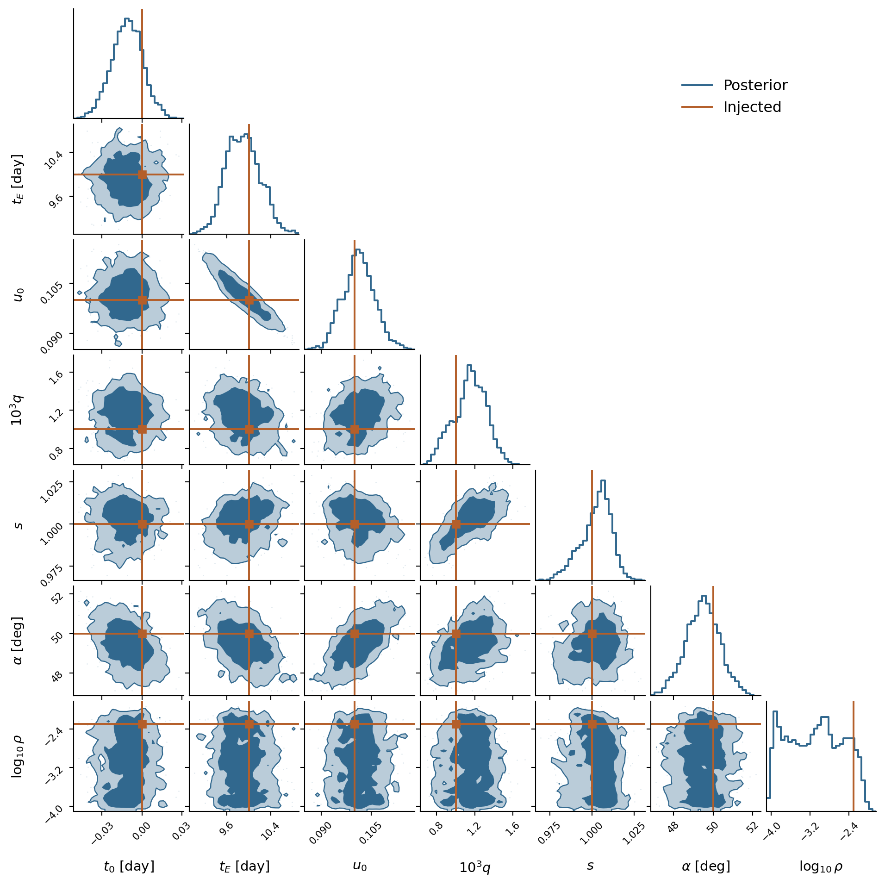

HMC injection–recovery
======================

This example fits noisy photometry of the :doc:`binary event <usage>` with
NumPyro's NUTS sampler on CPU. We sample the seven event parameters and
analytically marginalize the source and blend fluxes under Gaussian priors.
We draw both fluxes from their conditional posterior for the corner plot.

Example results
---------------

The figures below use the run from 9 November 2026 at
`0529a12 <https://github.com/ShotaMiyazaki94/microjax/commit/0529a12>`_:
360 observations with 3% flux errors, 500 warm-up steps, and 1,000 retained
draws. The priors and sampler settings are described below.
NUTS took **190 seconds**, including compilation and warm-up; the local fit
took another 9.72 seconds. This used six CPU workers, double precision,
JAX 0.8.0, and NumPyro 0.19.0. Curve evaluation and plotting are outside
those timings.

The sampler reported **no divergences**, and no iteration reached the
tree-depth limit. Effective sample sizes (ESS) range from 308 to 687.

   Full event and a closer view of the peak. Grey points are the 360
   observations; orange is the injected curve. Blue shows the median and
   central 68% model interval from 64 posterior draws, including the uncertainty
   in source and blend fluxes. Models are evaluated at 5,519 times, with
   spacing at most 0.0025 days around the peak.

The lower panels use the **injected curve as the common reference**. Grey
points show :math:`(F_{\rm data}-F_{\rm inj})/\sigma`; the blue line and band
show the corresponding posterior-model differences. At every plotting time,
:math:`\sigma(t)=0.03F_{\rm inj}(t)`, the standard deviation of the noise
added to the observations. Zero therefore represents the injected curve.

   The seven event parameters and :math:`F_s`, :math:`F_b`. Diagonal panels
   show marginal distributions; lower panels show pairwise
   correlations. Blue contours enclose approximately 68% and 95% of the
   smoothed distributions in the displayed coordinates. Orange marks the
   injected values. Each of the 1,000 event draws is paired with a joint draw
   of :math:`F_s` and :math:`F_b` from their conditional Gaussian posterior.

The :math:`t_E`–:math:`u_0` and :math:`q`–:math:`s` correlations are visible
in the corner plot. The source radius remains weakly constrained: its
distribution spans roughly two orders of magnitude, so :math:`\rho` is
shown logarithmically.

.. csv-table:: Event-parameter summaries from this run
   :header: "Parameter", "Injected", "Median", "Central 95% interval", "ESS"
   :widths: 18 14 18 36 14

   ":math:`t_0` [day]", "0", "−0.01090", "[−0.03467, 0.01311]", "617"
   ":math:`t_E` [day]", "10", "9.884", "[9.336, 10.508]", "687"
   ":math:`u_0`", "0.1", "0.10135", "[0.09212, 0.11121]", "671"
   ":math:`q`", "0.001", "1.16×10⁻³", "[8.04×10⁻⁴, 1.47×10⁻³]", "308"
   ":math:`s`", "1", "1.00399", "[0.98171, 1.01737]", "323"
   ":math:`\alpha` [deg]", "50", "49.51", "[47.72, 51.19]", "561"
   ":math:`\rho`", "0.005", "8.47×10⁻⁴", "[1.09×10⁻⁴, 7.05×10⁻³]", "386"

All seven injected values lie in the reported 95% intervals.

Running the example
-------------------

From a :doc:`local copy of the repository <getting_started>`:

.. code-block:: sh

   python -m pip install -e . 'numpyro>=0.19' scipy matplotlib corner
   python example/hmc/injection_recovery.py

The script starts from a rough initial guess and uses the local fit's
covariance to whiten the sampling coordinates.
It runs **one chain with 500 warm-up steps and 1,000 retained draws in total**.
Each model evaluation distributes observation times across six CPU devices
with JAX ``pmap``;
the worker count does not multiply the number of draws. This follows the
time-parallel calculation in the
`microlux example <https://github.com/CoastEgo/microlux/blob/master/example/KB0371.py>`_.

Launch the script in a fresh Python process so the CPU devices can be
configured before importing microJAX. Compilation and the local fit happen
before the NUTS progress bar starts. Results go to ``results/hmc/binary/``;
each run replaces that directory. Settings are constants at the top of
``example/hmc/injection_recovery.py``.

Data and priors
---------------

The data contain 360 uniformly spaced observations from day −30 to day 30,
about one every 0.167 days (4 hours):

.. code-block:: python

   times = jnp.linspace(-30.0, 30.0, 360)

The flux model is

.. math::

   F(t) = F_s A(t; t_0,t_E,u_0,q,s,\alpha,\rho) + F_b.

Independent Gaussian noise has a standard deviation of 3% of the injected
flux at each time. Those error bars stay fixed in the fit. Linear limb
darkening is fixed at ``u1=0.5``. Injection and fitting use the same microJAX
model.

.. list-table:: Injected values and priors
   :header-rows: 1

   * - Parameter
     - Injected value
     - Prior
   * - :math:`t_0`
     - 0 days
     - Uniform(−1, 1) days
   * - :math:`t_E`
     - 10 days
     - LogUniform(1, 100) days
   * - :math:`u_0`
     - 0.1
     - Uniform(0, 1)
   * - :math:`q`
     - 0.001
     - LogUniform(10⁻⁴, 1)
   * - :math:`s`
     - 1.0
     - LogUniform(0.5, 2)
   * - :math:`\alpha`
     - 50°
     - Uniform(−π, π) radians
   * - :math:`\rho`
     - 0.005
     - LogUniform(10⁻⁴, 0.05)
   * - :math:`F_s`
     - 1.0
     - :math:`\mathcal{N}(0,10^2)`
   * - :math:`F_b`
     - 0.2
     - :math:`\mathcal{N}(0,10^2)`

Prior bounds are given in physical units. The time bounds assume the event epoch
is known to about one day and the event lasts weeks. The lens
bounds leave a wide range of mass ratios and source sizes around separations
of order one Einstein radius. They are rounded choices for this example,
not intervals fitted around the injected values or the local solution.
We use nonnegative :math:`u_0` and the full range of :math:`\alpha`.
The lower tail of :math:`\rho` approaches its prior cutoff; its posterior
interval depends on this choice when the data do not resolve the source size.

The two flux priors are independent,
untruncated Gaussians with mean zero and standard deviation 10 in the chosen
flux units. Their width is fixed independently of the injection and fit.

``PRIOR_BOUNDS`` and ``LOG_INDICES`` define the seven event priors;
``FLUX_PRIOR_SCALE`` sets the flux-prior standard deviation. ``TRUTH`` and
``FLUX_TRUTH`` are used only for data generation and recovery comparisons.
``INITIAL`` starts the local fit and does not define a prior.

Marginalizing the fluxes
------------------------

For each trial event, let :math:`M=[A,1]` and
:math:`V=\mathrm{diag}(\sigma^2)`. With
:math:`\beta=(F_s,F_b)^\mathsf{T}\sim\mathcal{N}(0,\Lambda)` and
:math:`\Lambda=10^2 I`, integrating over both fluxes gives

.. math::

   p(f\mid\theta) = \mathcal{N}\!\left(f;\,0,\,V+M\Lambda M^\mathsf{T}\right).

Here :math:`f` contains the observed fluxes and :math:`\theta` the seven
event parameters. The script uses :func:`microjax.likelihood.nll_ulens` to
evaluate this Gaussian marginal likelihood analytically through a two-by-two system,
including its determinant term. No numerical integration is needed.

For plotting, the conditional flux posterior is also Gaussian, with
inverse covariance :math:`B=\Lambda^{-1}+M^\mathsf{T}V^{-1}M` and mean
:math:`B^{-1}M^\mathsf{T}V^{-1}f`. After NUTS, we draw the two fluxes jointly
for each saved event sample. These nine-variable samples retain both the
flux uncertainties and their correlations with the event parameters in
the corner plot. The 64 model curves use a subset of the same samples.

The NumPyro model therefore samples only the seven event parameters:

.. literalinclude:: ../example/hmc/injection_recovery.py
   :language: python
   :pyobject: model

Initialization and sampling
---------------------------

L-BFGS-B finds a local posterior mode from ``INITIAL`` in unbounded logit
coordinates :math:`z`. Both this fit and NUTS use the marginal likelihood
and event priors above, including the coordinate-transform Jacobian.

At that solution, the script estimates a covariance :math:`C_{\rm fit}`
from the fitted flux residuals and transformed prior curvature. The residual
Jacobian uses ``jax.jacfwd``, following the approach in
`numpyro-inferutils <https://github.com/kemasuda/numpyro-inferutils>`_.
This defines the whitened sampling coordinates :math:`w`:

.. math::

   z = z_{\mathrm{fit}} + Lw, \qquad LL^\mathsf{T} = C_{\mathrm{fit}}.

NUTS starts near :math:`w=0` with an identity mass matrix. Warm-up adapts
the dense mass matrix and step size, then holds them fixed for the retained
draws. The whitening transform stays fixed throughout.
Sampling uses the priors and full marginal likelihood described above.

The sampler uses ``forward_mode_differentiation=True`` for the CPU
integrator's adaptive loops, ``target_accept_prob=0.9``, and
``max_tree_depth=10``. The chain explores the mode near the initial solution.

Saved output
------------

``run.json`` records settings, priors, fit status, seeds, and software versions.
``summary.json`` contains the parameter intervals and sampler diagnostics.
``samples.npz`` stores the seven physical parameters with shape ``(1, 1000)``;
angles remain in radians. These files are saved before the model curves
are evaluated.

``curves.npz`` stores a separate dense time grid, the injected curve, and 64
posterior flux curves. Its ``flux_draws`` array has shape ``(1000, 2)``:
each row contains :math:`F_s` and :math:`F_b` for the corresponding saved
event sample. ``sample_indices`` selects the 64 pairs used for the curves.
The fluxes are conditioned on the observations. Extra plotting times add
resolution to the figure and do not enter the likelihood.

To redraw the two figures from these saved arrays:

.. code-block:: sh

   python example/hmc/plot.py

This does not evaluate microJAX or run NUTS.
