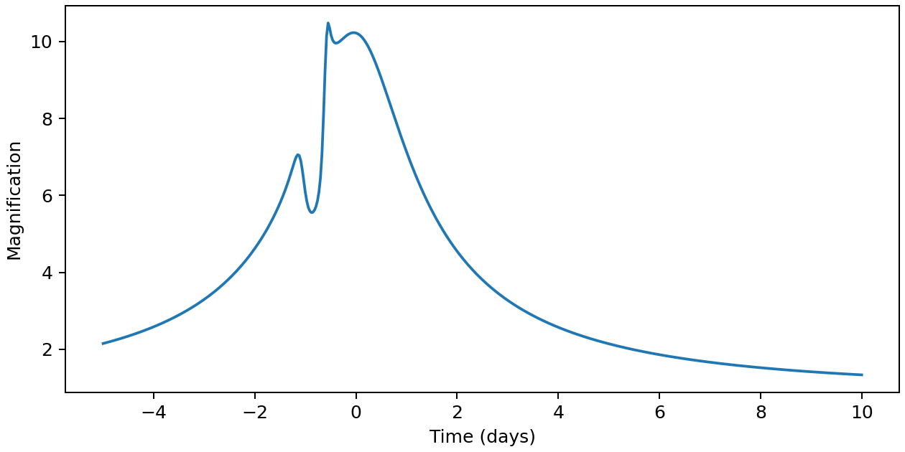

A binary light curve
====================

Let's calculate a microlensing event produced by a star and a low-mass
companion. We will describe the source's motion across the sky, evaluate its
magnification, and plot the result. The same steps apply to a stellar binary;
only the lens parameters change.

Setting up the event
--------------------

We use ``jax.numpy`` for arrays and Matplotlib for the plot. Enable double
precision at the start: resolving the small images near a caustic needs more
precision than JAX's default 32-bit arithmetic.

.. code-block:: python

   import jax
   jax.config.update("jax_enable_x64", True)

   import jax.numpy as jnp
   import matplotlib.pyplot as plt
   from microjax.inverse_ray import mag_binary

A source position is represented by a complex number, ``w = x + 1j*y``.
The real axis runs along the binary, and the origin is its centre of mass.
Distances are measured in angular Einstein radii for the total lens mass.

For straight-line motion, we need four event parameters: the time of closest
approach ``t0``, the Einstein crossing time ``t_e``, the impact parameter
``u0``, and the trajectory angle ``alpha``. Here, all times are in days and
the angle is converted to radians:

.. code-block:: python

   times = jnp.linspace(-5.0, 10.0, 500)
   t0, t_e, u0 = 0.0, 10.0, 0.1
   alpha = jnp.deg2rad(50.0)

   tau = (times - t0) / t_e
   w = (tau + 1j * u0) * jnp.exp(1j * alpha)

``tau + 1j*u0`` describes motion parallel to the real axis; multiplying by
``exp(1j*alpha)`` rotates the path. The trajectory passes 0.1 Einstein radii
from the origin at day zero. This defines the geometry, rather than the
time of peak magnification, which also depends on the lens.

Calculating the magnification
-----------------------------

Choose a companion-to-primary mass ratio of ``q=0.001`` and a separation of
``s=1`` Einstein radius. The source has radius ``rho=0.005`` and a linear
limb-darkening coefficient ``u1=0.5``, so its edge is darker than its centre.

.. code-block:: python

   A = mag_binary(w, rho=0.005, s=1.0, q=0.001, u1=0.5, backend="cpu")

``A`` contains one magnification for each of the 500 observation times.
The ``backend="cpu"`` setting selects the CPU integrator used throughout
this tutorial. :doc:`working_with_jax` explains how to run the same model
on a GPU.

.. code-block:: python

   fig, ax = plt.subplots(figsize=(7, 3.5), layout="constrained")
   ax.plot(times, A, color="C0")
   ax.set(xlabel="Time (days)", ylabel="Magnification")
   plt.show()

   The light curve from the code above.

The broad brightening is interrupted by a short feature before the peak.
This is where the source passes near the binary's caustic, a curve along
which the magnification of a point source diverges. Giving the source a
finite radius smooths the feature. Try increasing ``rho`` to see how it
changes, or changing ``q`` to explore a more massive companion.

Magnification to observed flux
------------------------------

microJAX returns the magnification. To compare it with photometry, combine
it with the source flux :math:`F_s` and any constant blended light
:math:`F_b`:

.. math::

   F(t) = F_s A(t) + F_b.

The unlensed baseline is :math:`F_s+F_b`. This lets you use the same
magnification curve with different flux scales for different data sets.
The :doc:`flux-fitting functions <api/likelihood>` can solve for these two
fluxes given a magnification curve and observed photometry.

Next, :doc:`autodiff` shows how to calculate derivatives of this event.
For a third lens, continue to the :ref:`triple example <triple-example>`.
The :doc:`finite-source reference <api/inverse_ray_lightcurve>` gives the
complete coordinate and brightness conventions.
