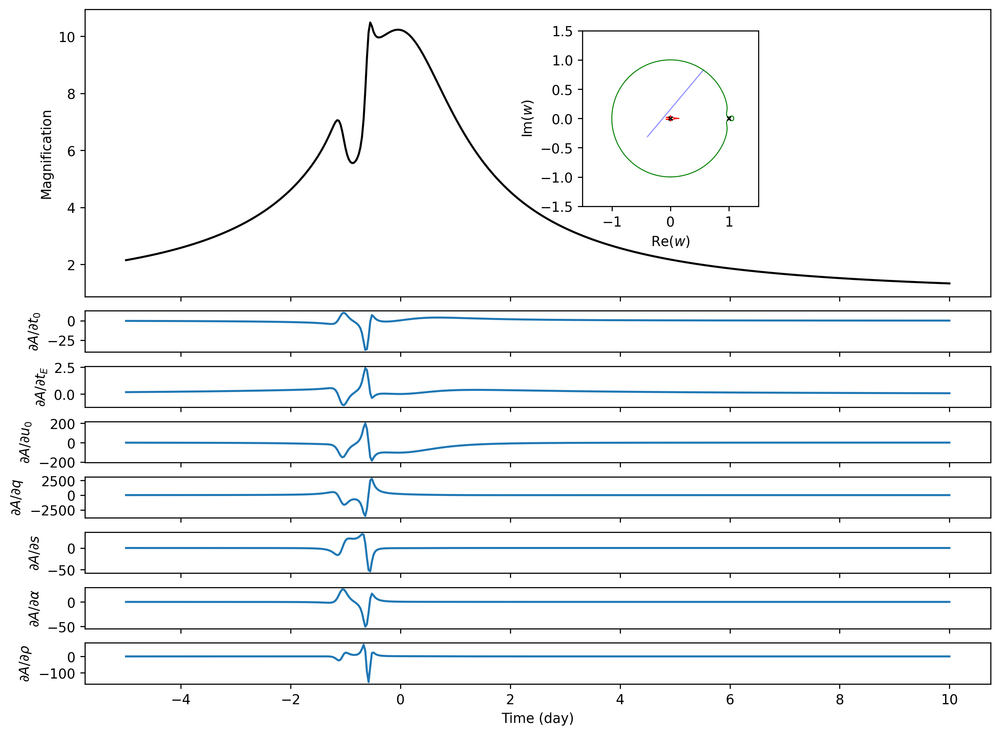

# CPU example

Run from the repository root:

```bash
python -m pip install -e . matplotlib
python example/cpu/lightcurve.py
```

[`lightcurve.py`](lightcurve.py) evaluates a binary-lens light curve with linear
limb darkening (`u1=0.5`) and uses `jax.jacfwd` for the seven parameters
`t0, tE, u0, q, s, alpha, rho`. The limb-darkening coefficient stays fixed.
The script enables float64 and selects `backend="cpu"` on the CPU explicitly;
the first evaluation includes JAX compilation.

The parameters, sampling and figure layout match the
[GPU limb-darkened Jacobian example](../gpu/jacobian-binary/outputs/limb_dark/binary_limb_dark_jacobian.png):
500 times from −5 to 10 days, with `t0=0`, `tE=10`, `u0=0.1`, `q=0.001`,
`s=1`, `alpha=50°`, and `rho=0.005`. The figure below is calculated by the CPU
backend. Its upper panel shows magnification with a caustic, critical-curve and
source-trajectory inset; the seven lower panels show the parameter derivatives
in the order listed above.



Edit the parameters and time grid in `main()` to explore another event.
`u1=0` uses the same implementation for a uniform source.

The script writes `lightcurve.png`, `lightcurve.csv` (time and magnification),
and `jacobian_forward.npy` (500 × 7) to `results/cpu/example/`. These runtime
outputs stay local and are excluded from Git. Only the representative README
preview is versioned here; to refresh it after running the script:

```bash
cp results/cpu/example/lightcurve.png example/cpu/lightcurve.png
```

This is a usage example. Accuracy and speed measurements live in
[`tools/cpu_benchmark.py`](../../tools/cpu_benchmark.py); regional maps and
uncertainty plots are described in [CONTRIBUTING.md](../../CONTRIBUTING.md).
