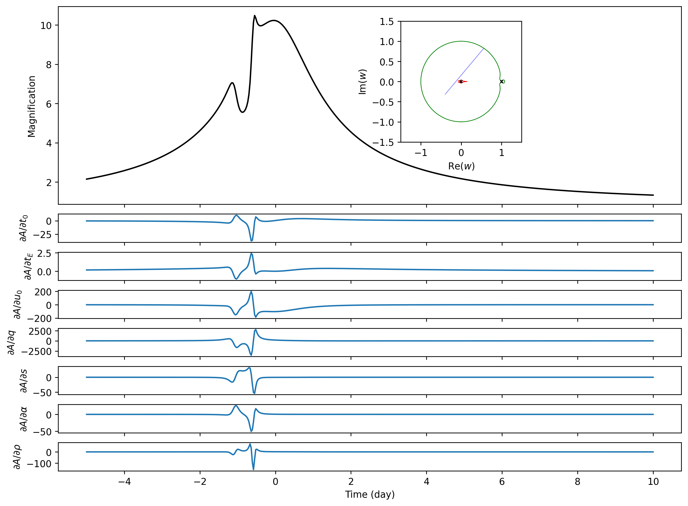

# Binary-lens Jacobian on GPU

```bash
python example/gpu/jacobian-binary/code/grads_limb_dark_binary.py
```

Run from the repository root with microJAX, Matplotlib, and CUDA-enabled JAX
installed. The script evaluates a limb-darkened light curve and its forward
Jacobian with `jax.jacfwd`; `u1=0.5` is held fixed.

The event has `t0=0`, `tE=10` days, `u0=0.1`, `q=0.001`, `s=1`,
`alpha=50°`, and `rho=0.005`. There are 500 observations from −5 to 10 days.
Jacobian columns follow `t0, tE, u0, q, s, alpha, rho`.



The [CPU example](../../cpu/README.md#binary-lens) evaluates the same event
with `backend="cpu"` and produces the same panel layout.

## Options and outputs

Use `--quick` for a smaller run, `--u1` to change limb darkening,
`--n-points` to change the time sampling, and `--output-dir PATH` to change
the destination. `--no-plot` writes only data and timings. The source-boundary
sampling defaults to `n_limb=64` and can be changed with `--n-limb`.

Each run writes to `outputs/limb_dark/`: `magnification.csv`, a `(500, 7)`
`jacobian_forward.npy`, `benchmark.json`, the light-curve figure, and
`ad_benchmark.png`. The report separates compilation plus the first call
from the median of three synchronized warm calls; change this count with
`--repeats`.

The numerical outputs, timing reports, and diagnostic plots stay local and
are excluded from Git. Only the representative Jacobian figure above is
versioned.

For magnification accuracy, see the separate
[VBMicrolensing comparison](../compare-binary-vbml/README.md).
