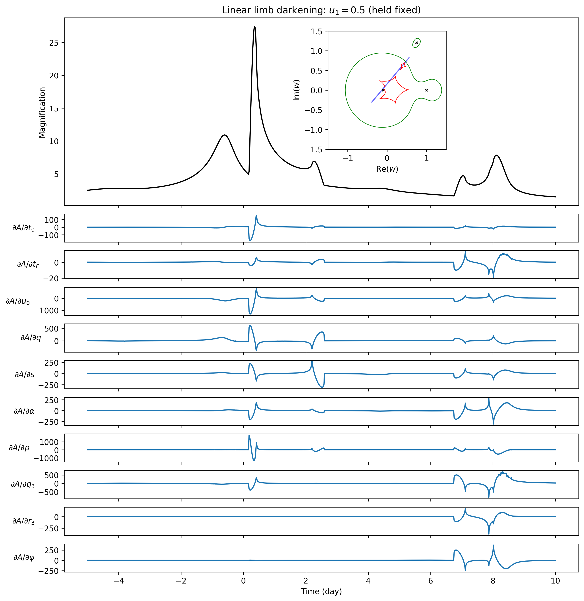

# Triple-lens Jacobian on GPU

This example calculates a triple-lens light curve and shows how it changes
with each event parameter. Run it from the repository root with microJAX,
Matplotlib, and GPU-enabled JAX installed:

```bash
python example/gpu/jacobian-triple/code/grads_limb_dark_triple.py
```

The calculation uses `jax.jacfwd` with limb darkening fixed at `u1=0.5`.

The event has `t0=0`, `tE=10` days, `u0=0.1`, `q=0.1`, `s=1.1`,
`alpha=50°`, `rho=0.01`, and `q3=0.01`. The third lens is at `0.3+1.2j`
relative to the midpoint of the first two lenses. There are 1000 observations
from −5 to 10 days. Jacobian columns follow
`t0, tE, u0, q, s, alpha, rho, q3, r3, psi`.



The [CPU example](../../cpu/README.md#triple-lens) evaluates the same event
with `make_triple_lightcurve(times, backend="cpu")` and produces the same
panel layout.

## Changing the example

Use `--quick` for a smaller run, `--u1` to change limb darkening, or
`--n-points` to change the time sampling. Run the script with `--help` for
all options.

The light curve, Jacobian array, figures, and timing report are saved under
`outputs/limb_dark/`. Set `--output-dir PATH` to use another directory.
The timing report separates the first call, which includes compilation,
from subsequent calls.

For magnification accuracy, see the
[VBMicrolensing comparison](../compare-triple-vbml/README.md).
